## Statova Nadejda IA2404, Informatica Aplicata, номер 24, продвинутый уровень

## Скриншоты базового уровня

| Подсеть   | Зона доступности | Диапазон      | Первый и последний доступные IP | Количество доступных IP |
|-----------|------------------|---------------|--------------------------------|-------------------------|
| public-a  | eu-central-1a    | 10.24.0.0/24  | 10.24.0.4 – 10.24.0.254       | 251                     |
| public-b  | eu-central-1b    | 10.24.1.0/24  | 10.24.1.4 – 10.24.1.254       | 251                     |
| private-a | eu-central-1a    | 10.24.10.0/24 | 10.24.10.4 – 10.24.10.254     | 251                     |
| private-b | eu-central-1b    | 10.24.11.0/24 | 10.24.11.4 – 10.24.11.254     | 251                     |

#### Задание 3: маршруты public-rt и private-rt и их связи с подсетями.

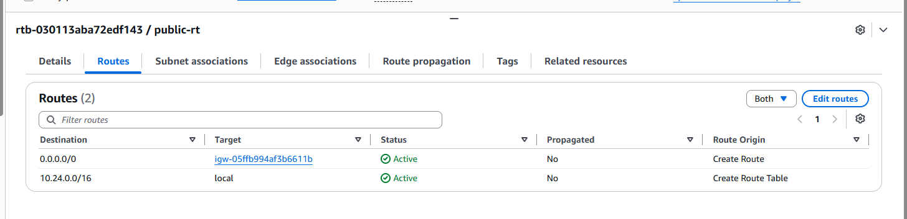
*Маршруты public-rt*

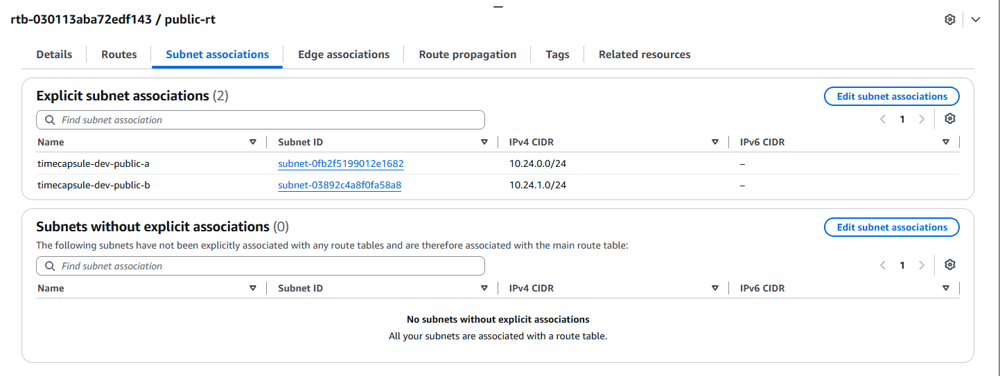
*Связи public-rt с подсетями*

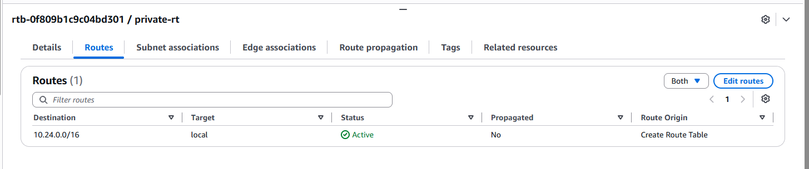
*Маршруты private-rt*

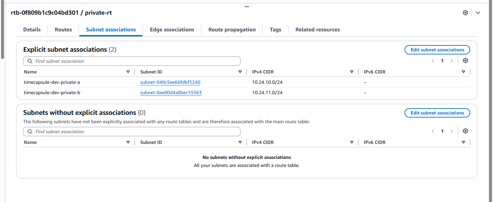
*Связи private-rt с подсетями*

#### Задание 4: входящие правила трёх Security Group

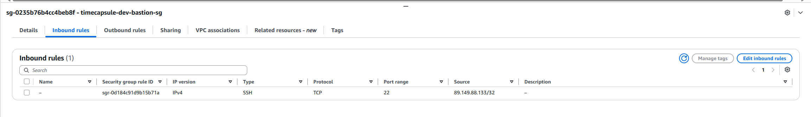
*Входящие правила timecapsule-dev-bastion-sg*

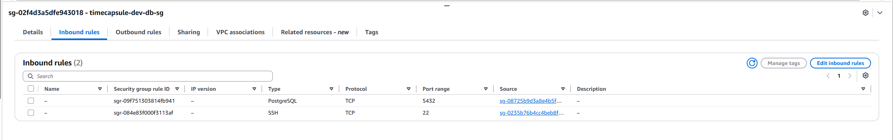
*Входящие правила timecapsule-dev-db-sg*

*Входящие правила timecapsule-dev-web-sg*

#### Задание 5: страница web-server в браузере.

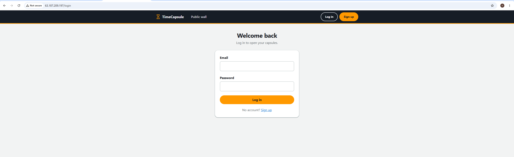
*Страница web-server* 

#### Задание 6: вывод curl https://checkip.amazonaws.com на db-server, маршрут в состоянии Blackhole и список NAT gateways, где шлюз в состоянии Deleted

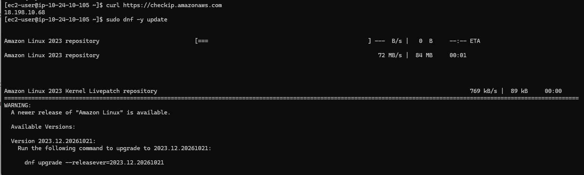
*Вывод curl https://checkip.amazonaws.com на db-server*

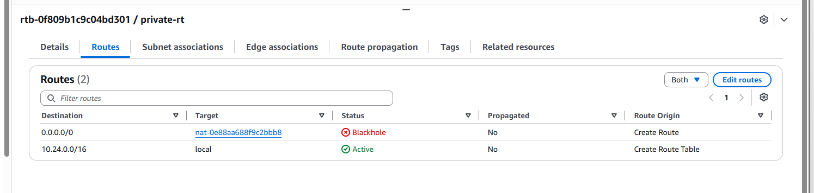
*Маршрут в состоянии Blackhole*

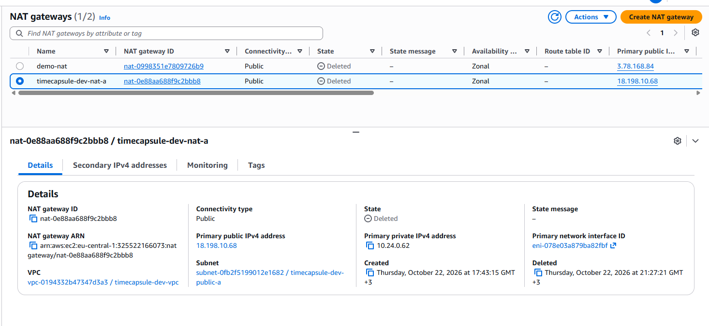
*NAT gateways, где шлюз в состоянии Deleted*

#### Задание 7: вывод psql с web-server, проверка порта 5432 с web-server и bastion, результат эксперимента с Network ACL, список ресурсов в Tag Editor с тегом Project = timecapsule

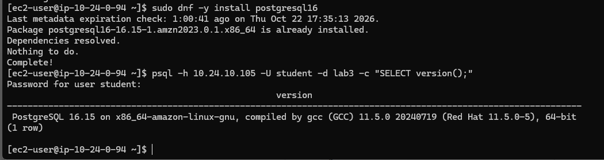
*Вывод psql с web-server*

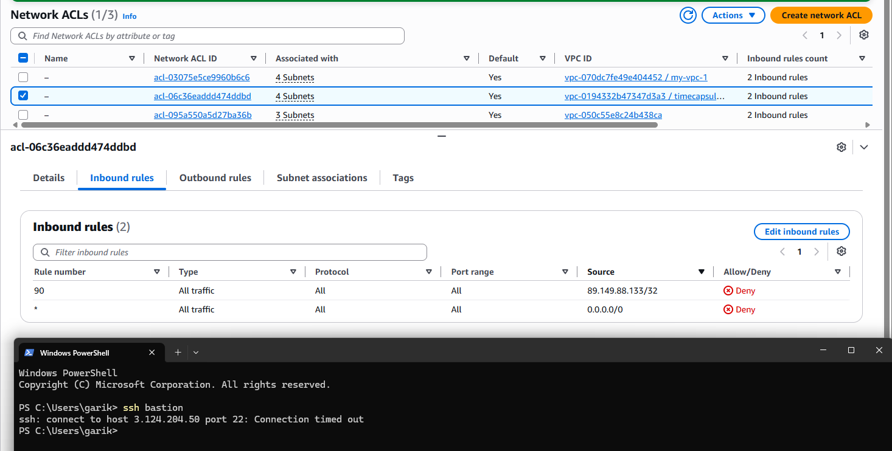
*dev-bastion timeout при изменении inbound rules*

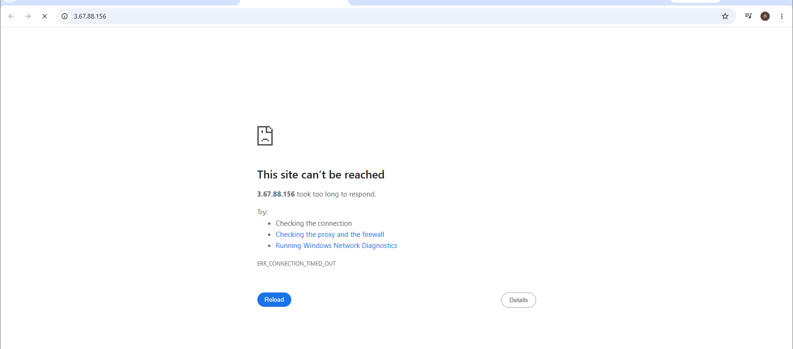
*dev-web unavailable при изменении inbound rules*

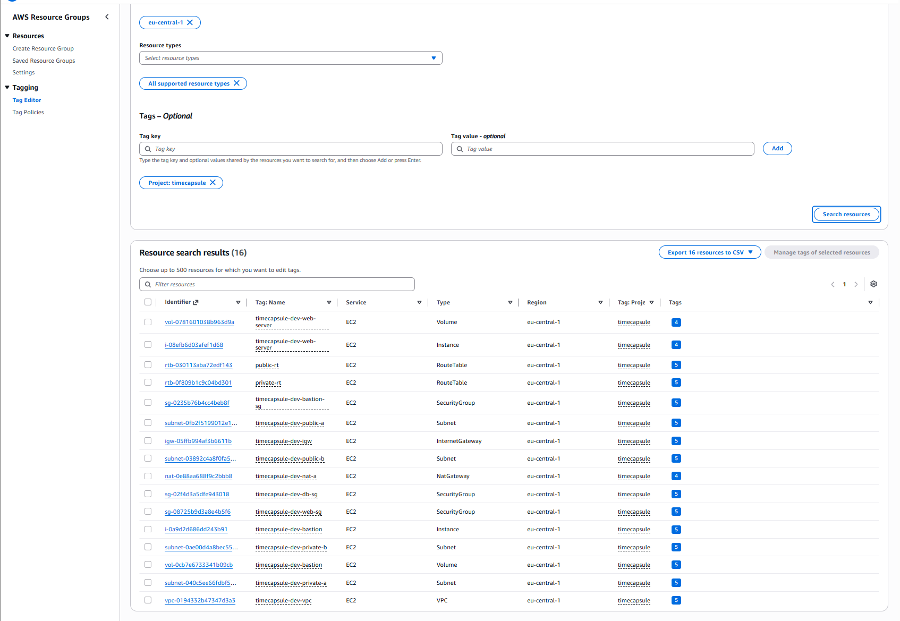
*Список ресурсов в Tag Editor*

## Скриншоты продвинутого уровня:

### Задание 9: приложение в браузере по Elastic IP.

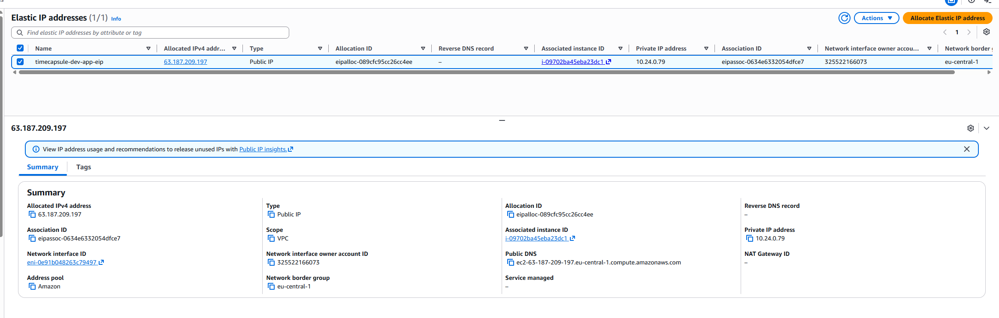
*Созданный Elastic IP*

*Приложение в браузере по Elastic IP*

#### Задание 11: запись db в зоне и вывод dig с app-server и dig или nslookup с вашего компьютера.

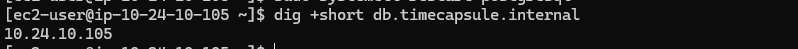
*Вывод dig с app-server*

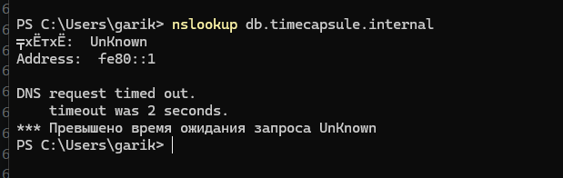
*Вывод nslookup с компьютера*

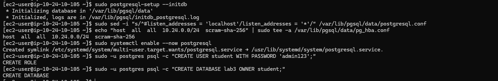
*Настройка postgres*

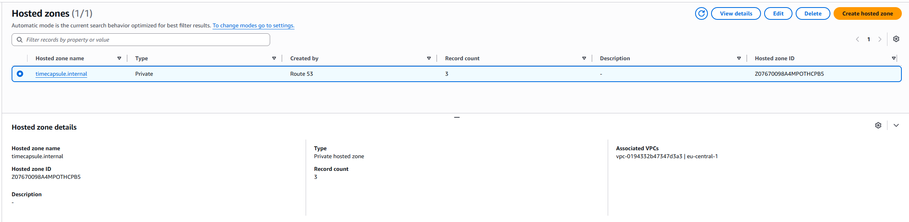
*Hosted zone*

#### Задание 12: вывод psql -f, ответ /health и капсулы из ЛР2 на странице.

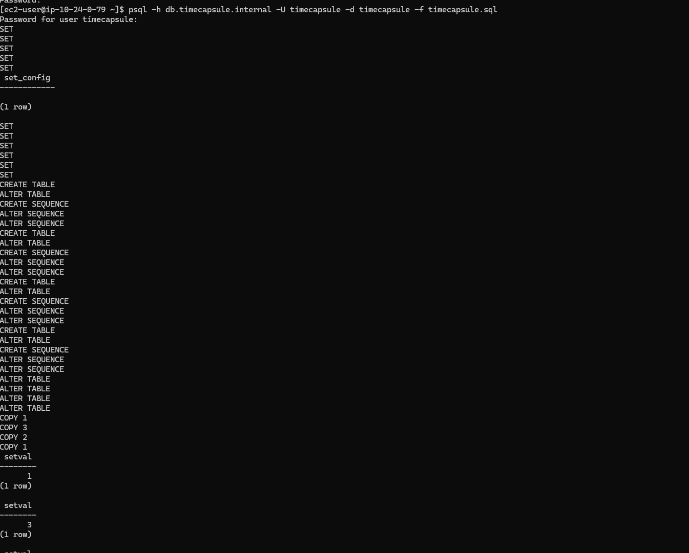
*Вывод psql -f*

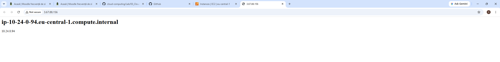
*ответ /health*

#### Задание 13: 

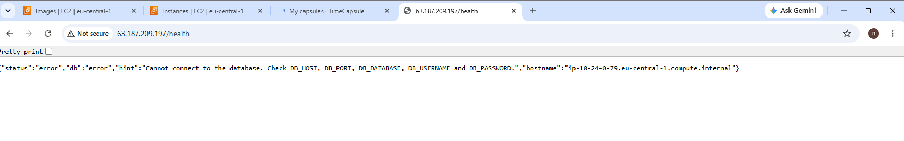
*/health при остановленной базе*

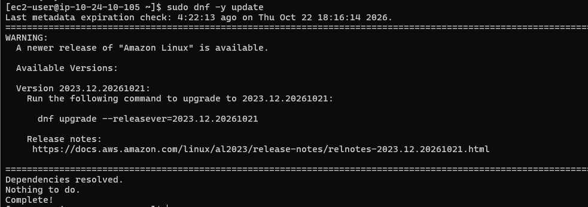
*вывод sudo dnf -y update на db-server*

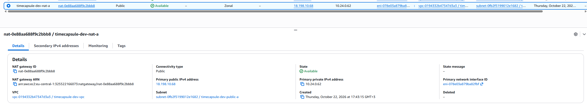
*NAT Gateway info*

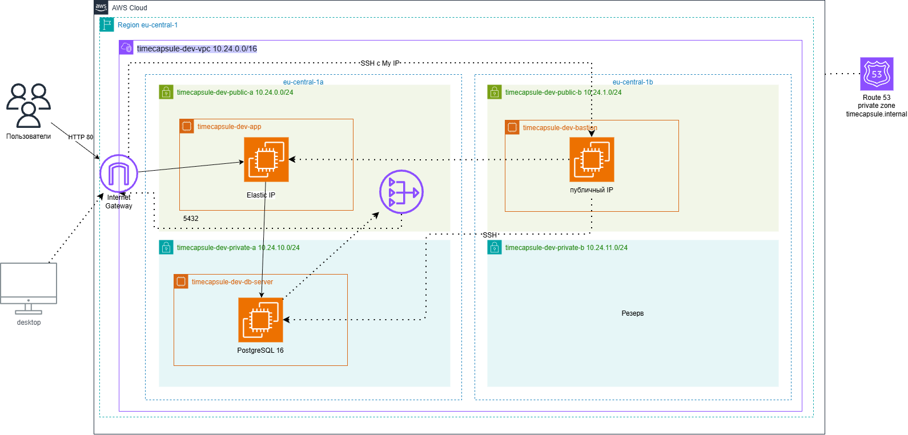
*Схема работы*

